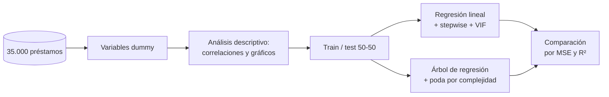

# Predicción del monto de préstamos personales

Modelo en R para estimar cuánto dinero pide cada cliente de una institución financiera, comparando **regresión lineal múltiple** y **árbol de regresión**.

> Trabajo grupal de Analítica de Negocios y Big Data, Licenciatura en Negocios Digitales, Universidad ORT Uruguay, 2024.

## El problema

La institución quiere entender qué características del cliente explican el monto que pide, para predecirlo y ajustar su oferta y su gestión de riesgo. La base tiene **35.000 préstamos y 12 variables**.

## Resultados

| Indicador | Regresión lineal | Árbol de regresión |
|---|---|---|
| R² | 95,67 % (ajustado) | 86,94 % (test) |
| MSE test | 47.986.853 | 165.822.160 |
| Sobreajuste | No | No |

- Los **ingresos** empujan el monto para arriba (r = 0,83) y el **crédito disponible** lo baja (r = -0,69).
- Género, región y sector de empleo no resultaron significativos.
- **Conclusión:** la regresión lineal predice mejor y es más fácil de interpretar. El árbol suma valor para segmentar clientes con reglas simples.

## Estructura del repo

```
prestamos-regresion-r/
├── r/
│   └── analisis_prestamos.R   descriptivo, regresión, árbol y comparación
├── data/README.md             diccionario de las 12 variables
└── docs/conclusiones.md       ecuación del modelo, métricas e interpretación
```

## Pipeline



## Cómo correrlo

1. Instalá R. El script instala solo los paquetes que falten.
2. Ubicá la base en `data/Datos 2024.csv` (ver [data/README.md](data/README.md)).
3. Desde la raíz del repo:
   ```r
   source("r/analisis_prestamos.R")
   ```

## Decisiones de diseño

- **Default fuera del modelo**, como pedía la consigna para predecir el monto.
- **Variables categóricas como dummies**, para poder usarlas en la regresión.
- **Stepwise en las dos direcciones** para quedarnos solo con las variables significativas.
- **Validación con train y test 50-50** y semilla fija, para medir sobreajuste y que el resultado sea reproducible.
- **Poda del árbol** con el parámetro de complejidad de menor error de validación cruzada.

## Stack

R · rio · car · rpart · rpart.plot · rattle

---

**Romina Cor Castro** · [Portafolio](https://rominacor21.github.io) · [LinkedIn](https://www.linkedin.com/in/rominacor/)
